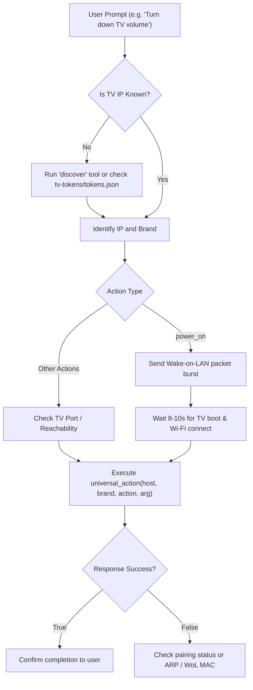

# Smart TV Control Skill

## Overview

This skill equips AI assistants (Claude, Gemini, Antigravity, Cursor, ChatGPT, Codex) with the knowledge and procedures to discover, connect to, and control smart TVs across all major manufacturers (LG, Samsung, Roku, Android/Google TV, Fire TV, Sony, Vizio, and Philips) using the TV Remote MCP server.

---

## When to Use

Use this skill when:
- The user asks to turn the TV on or off (e.g. *"turn off the TV when you finish this coding task"* or *"wake up the TV"*).
- Adjusting audio settings (e.g. volume up, down, mute, or setting absolute volume level).
- Navigating TV menus, settings, or home screen (D-pad up, down, left, right, enter, back, home).
- Launching streaming apps (YouTube, Netflix, Prime Video, Disney+, Spotify, Web Browser).
- Switching video inputs (HDMI 1, HDMI 2, Live TV).
- Discovering smart TVs connected to the local Wi-Fi / LAN.
- Pairing with a new TV or diagnosing connection issues.

---

## Available MCP Tools

When the TV Remote MCP server (`server/mcp-server.py`) is active, the following tools are exposed:

### 1. `universal_action`
Execute any control command on a target smart TV.

```typescript
universal_action({
  host: string,     // TV IP address, e.g. "192.168.1.11"
  brand: string,    // Brand ID: "lg", "samsung", "roku", "android", "fire_tv", "sony", "vizio"
  action: string,   // Action name (see Action Reference below)
  arg?: string      // Optional parameter (e.g. volume level "25", app ID "youtube.leanback.v4")
})
```

### 2. `discover`
Scan the local network for smart TVs and return discovered devices with IP, port, brand, model name, and MAC address.

```typescript
discover({
  network?: string  // Optional subnet prefix (e.g. "192.168.1.")
})
```

### 3. `list_brands`
Returns the list of supported smart TV brand identifiers.

---

## Supported Action Reference

| Action Name | Description | Argument (`arg`) | Example / Note |
|---|---|---|---|
| `power_on` | Wakes TV using Wake-on-LAN (WoL) | MAC address (optional if paired) | Sends 5 UDP packets to ports 9/7. Takes ~5-10s to boot. |
| `power_off` | Powers down the TV into standby | *(none)* | Cleanly disconnects session and shuts down display. |
| `volume_up` | Increases audio volume by 1 step | *(none)* | Can be called sequentially for multi-step changes. |
| `volume_down` | Decreases audio volume by 1 step | *(none)* | Single step decrement. |
| `mute` | Toggles or sets audio mute | *(none)* | Mutes/unmutes audio output. |
| `volume_set` | Sets volume to an exact level | Integer string `0`–`100` | E.g. `arg: "20"` sets volume to 20%. |
| `up`, `down`, `left`, `right` | Directional navigation pad | *(none)* | Navigates menus, guides, and UI carousels. |
| `enter` | Select / OK / Click | *(none)* | Activates currently focused element. |
| `back` | Return to previous screen | *(none)* | Back button. |
| `home` | Open Smart TV Home screen | *(none)* | Returns to dashboard/launcher. |
| `media_play` | Resume media playback | *(none)* | Standard playback controls. |
| `media_pause` | Pause media playback | *(none)* | Freezes playback. |
| `media_stop` | Stop playback | *(none)* | Stops video/audio stream. |
| `launch_app` | Launch streaming application | App ID or package name | See [App IDs Reference](./references/app-ids.md). |
| `list_apps` | Enumerate installed applications | *(none)* | Returns list of app IDs and titles (LG WebOS). |
| `set_input` | Switch video input source | Input identifier | E.g. `arg: "HDMI_1"`. |

---

## Connection & Execution Channels

AI assistants can interact with smart TVs via three primary channels depending on the runtime environment:

### Channel A: Native MCP Tool Call (Preferred)
If running inside an MCP-enabled client (Antigravity, Claude Desktop, Cursor):
```json
{
  "name": "universal_action",
  "arguments": {
    "host": "192.168.1.11",
    "brand": "lg",
    "action": "volume_up"
  }
}
```

### Channel B: Fast CLI Script (Direct Agent Execution)
Agents with shell command execution (`run_command`) can invoke the standalone CLI helper:
```bash
# Discover TVs
python skills/smart-tv-control/scripts/tv_cli.py discover

# Send command
python skills/smart-tv-control/scripts/tv_cli.py action 192.168.1.11 lg volume_up

# Turn TV on via Wake-on-LAN
python skills/smart-tv-control/scripts/tv_cli.py power_on 192.168.1.11

# Launch YouTube
python skills/smart-tv-control/scripts/tv_cli.py launch 192.168.1.11 lg youtube.leanback.v4
```

### Channel C: HTTP JSON-RPC Bridge
If the MCP server is running on port 8000 or the local relay is running on port 7070:
```bash
# MCP Server RPC Bridge (port 8000)
curl -X POST http://localhost:8000/rpc \
  -H "Content-Type: application/json" \
  -d '{"host": "192.168.1.11", "brand": "lg", "action": "volume_up"}'

# Relay Server API (port 7070)
curl -X POST http://localhost:7070/api/command \
  -H "Content-Type: application/json" \
  -d '{"ip": "192.168.1.11", "brand": "lg", "action": "volume_up"}'
```

---

## Step-by-Step Procedure for AI Agents



### Step 1: Identify TV Host and Brand
1. Check `tv-tokens/tokens.json` for previously paired devices.
2. If unknown or new network, call `discover()` or `python skills/smart-tv-control/scripts/tv_cli.py discover`.

### Step 2: Handle Power-On (Wake-on-LAN)
- When a smart TV is powered off, its TCP ports (3001, 8001, etc.) are closed.
- Calling standard commands will fail immediately.
- Use `action: "power_on"`. This transmits a 5-packet UDP magic packet burst to the TV's MAC address across global broadcast (`255.255.255.255`), subnet broadcast, and unicast IP.
- **Important**: Allow 8–12 seconds for the TV hardware to boot and establish Wi-Fi association before sending subsequent control commands.

### Step 3: Execute Action & Handle Multi-step Sequences
- For volume changes by N steps (e.g. "turn down volume by 5"), invoke `volume_down` 5 times with a brief delay (100ms) or call `volume_set`.
- For app launching, use the platform-specific app identifier from [App IDs Reference](./references/app-ids.md).

### Step 4: Pairing a New TV
- **LG WebOS**: First command triggers an onscreen prompt: *"Allow connection to TV Remote MCP?"*. Prompt the user to press "Yes" using their physical TV remote. The returned `client_key` is automatically saved in `tv-tokens/tokens.json`.
- **Samsung Tizen**: Onscreen popup appears; user confirms with remote.
- **Roku**: Open REST API (port 8060); zero pairing required.
- **Android TV**: Enable Network Debugging in TV Developer Options; accept the RSA key prompt on TV.

---

## Detailed References

- [Brand Protocols and Network Ports Reference](./references/brand-protocols.md)
- [Application IDs and Inputs Reference](./references/app-ids.md)

---

## Security and Privacy Guidelines

1. **Pairing Tokens**: Never commit files in `tv-tokens/` (e.g. `tv-tokens/tokens.json`) or `.env` files to git. They contain private client keys and MAC addresses.
2. **Local Scope**: All commands communicate strictly across the user's private local network (LAN / Wi-Fi). No TV commands or private tokens are sent to external cloud servers.
